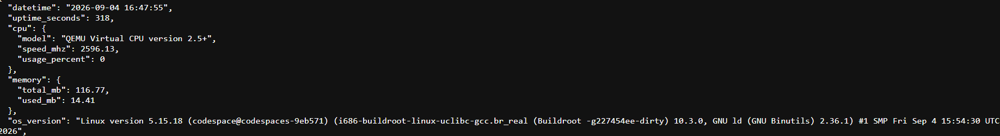
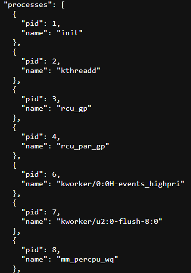
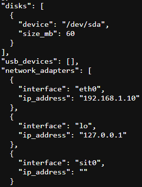

# SystemInfo

Trabalho Prático da disciplina de Laboratório de Sistemas Operacionais.

**Alunos:** Eduarda Rubin e Enzo Lauxen Stefanello

O projeto utiliza Buildroot para gerar uma distribuição Linux embarcada executada em QEMU. A imagem contém uma aplicação em Python 3 chamada `systeminfo.py`, executada automaticamente após o boot.

A aplicação cria um servidor HTTP na porta `8080` e disponibiliza o endpoint `GET /status`.

A resposta é retornada em formato JSON.

Todas as informações são obtidas dinamicamente a cada requisição através de arquivos em `/proc` e `/sys`. A aplicação utiliza apenas módulos da Python Standard Library.

## Funcionamento

O arquivo `systeminfo.py` é incluído na imagem final do Buildroot em:

`/usr/bin/systeminfo.py`

O script:

`/etc/init.d/S50systeminfo`

é executado automaticamente durante o boot e inicia o servidor Python.

O endpoint pode ser acessado pelo host com:

`curl http://192.168.1.10:8080/status`

Também pode ser acessado através da porta `8080` exposta no GitHub Codespaces, adicionando `/status` ao final da URL.

## Informações retornadas

### Data e hora

O campo `datetime` é calculado utilizando `/proc/stat` e `/proc/uptime`.

De `/proc/stat` é lido o campo `btime`, que representa o instante do boot. O tempo atual é calculado somando esse valor ao uptime.

### Uptime

O campo `uptime_seconds` é obtido de `/proc/uptime`.

### CPU

O modelo e a frequência são obtidos de `/proc/cpuinfo`.

O percentual de utilização é calculado através de duas leituras de `/proc/stat`, comparando os tempos totais e ociosos da CPU.

### Memória

Os dados são obtidos de `/proc/meminfo`.

São utilizados principalmente os campos `MemTotal` e `MemAvailable`.

A memória usada é calculada por:

`MemTotal - MemAvailable`

### Versão do sistema operacional

O campo `os_version` é obtido de `/proc/version`.

### Processos

Os processos são encontrados nos diretórios numéricos existentes em `/proc/`.

O PID corresponde ao nome do diretório e o nome do processo é obtido de:

`/proc/<pid>/comm`

### Discos

Os dispositivos são encontrados em `/sys/block/`.

O tamanho é obtido de:

`/sys/block/<device>/size`

O valor é convertido de setores de 512 bytes para MB.

### Dispositivos USB

Os dispositivos USB são procurados em `/sys/bus/usb/devices/`.

Quando disponíveis, são utilizados arquivos como:

- `manufacturer`
- `product`
- `idVendor`
- `idProduct`

No ambiente QEMU utilizado nos testes não havia dispositivos USB disponíveis, portanto o campo `usb_devices` foi retornado como uma lista vazia.

### Interfaces de rede

As interfaces são identificadas através de `/sys/class/net/`.

Os endereços IPv4 são obtidos de `/proc/net/fib_trie` e associados às interfaces utilizando `/proc/net/route`.

No ambiente utilizado, a interface principal foi:

`eth0 -> 192.168.1.10`

## Exemplo de resposta

```json
{
  "datetime": "2026-09-04 16:43:25",
  "uptime_seconds": 48,
  "cpu": {
    "model": "QEMU Virtual CPU version 2.5+",
    "speed_mhz": 2596.13,
    "usage_percent": 8.33
  },
  "memory": {
    "total_mb": 116.77,
    "used_mb": 14.32
  },
  "os_version": "Linux version 5.15.18 ...",
  "processes": [
    {
      "pid": 1,
      "name": "init"
    }
  ],
  "disks": [
    {
      "device": "/dev/sda",
      "size_mb": 60
    }
  ],
  "usb_devices": [],
  "network_adapters": [
    {
      "interface": "eth0",
      "ip_address": "192.168.1.10"
    },
    {
      "interface": "lo",
      "ip_address": "127.0.0.1"
    }
  ]
}
```

## Capturas de tela

### Resposta do endpoint `/status`



Captura mostrando a resposta do endpoint `/status` com os campos `datetime`, `uptime_seconds`, `cpu`, `memory` e `os_version`.

### Lista de processos



Captura mostrando a lista `processes`, contendo os campos `pid` e `name`.

### Discos, USB e interfaces de rede



Captura mostrando os campos `disks`, `usb_devices` e `network_adapters`.